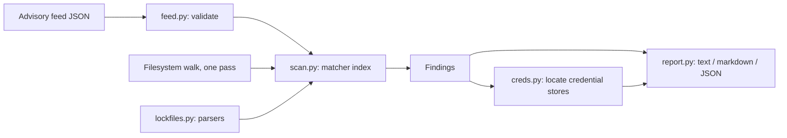

# blastradius

[](https://github.com/Nithinfgs/blastradius/actions/workflows/ci.yml)
[](LICENSE)


**A package you use just got compromised. Did it reach this machine, when, and what do you have to rotate?**

`blastradius` answers that offline in one command. You give it an advisory feed (a small JSON file describing the incident's indicators of compromise), and it sweeps your virtualenvs, `node_modules`, lockfiles, package caches, known malware file paths and shell history, then tells you:

- which environments have the bad release **installed**, and whether it was installed **inside the live window** or after the registry pulled it
- which **lockfiles** would pull it on the next install, and which **caches** could reinstall it offline
- whether the known malicious **files** are present (SHA-256 checked) and whether host artifacts left by the malware exist
- a **rotation checklist limited to the credential stores that actually exist on this machine** (paths only; it never opens them)

It exits `1` when it finds something, so it also works as a CI or fleet check.

## Why

Every few weeks a popular package is hijacked: litellm on 2026-10-21, dYdX, the Shai-Hulud npm worms. The first hour looks the same each time: someone pastes IOCs from a blog post, and you `grep` and `pip freeze` across the dozen virtualenvs, build caches and old project folders on your laptop and hope you did not miss one.

Existing tools do different jobs. `pip-audit`, `npm audit` and OSV-Scanner check one project's lockfile against an advisory database that may lag the incident. `blastradius` is a machine-wide, feed-driven incident-response sweep: a new incident is a new JSON file, not a new release of the tool. Research notes and the competing tools I looked at are in [docs/RESEARCH.md](docs/RESEARCH.md).

## Install

Requires Python 3.9+ and has no runtime dependencies.

```bash
git clone https://github.com/Nithinfgs/blastradius.git
cd blastradius
python3 -m venv .venv
.venv/bin/pip install .
```

Or run it straight from the checkout with no install: `PYTHONPATH=src python3 -m blastradius --help`.

## Quick start

Try the bundled demo first. It builds a fake compromised machine in a temp directory (benign files only) and scans it:

```bash
PYTHON=.venv/bin/python bash examples/demo.sh
```

Scan your own machine against every bundled advisory:

```bash
.venv/bin/blastradius scan
```

Scan only specific project folders against a specific feed, as JSON:

```bash
.venv/bin/blastradius scan --feed litellm-1.107.0-2026-10-21 --root ~/work --root ~/.cache/uv --format json
```

A full scan of a home directory with about 1.4 million files, 16,000 installed packages and 245 lockfiles took about 17 seconds on the development laptop (single run, macOS, SSD; yours will differ).

## Example output

From the demo (paths shortened):

```text
litellm-1.107.0-2026-10-21: COMPROMISED
  litellm 1.107.0 on PyPI: credential stealer and persistent backdoor
  Live window: 2026-10-21T11:39:00+00:00 to 2026-10-21T13:40:00+00:00
  [CRITICAL] cook.pth (distinctive IOC name) found in a Python environment
      .../api/.venv/lib/python3.12/site-packages/cook.pth
      Same environment also has the compromised release installed.
  [HIGH] litellm==1.107.0 is INSTALLED
      .../api/.venv/lib/python3.12/site-packages/litellm-1.107.0.dist-info
      timestamp: 2026-10-21T18:24:19+00:00 (after-pull)
  [MEDIUM] litellm==1.107.0 is pinned in a lockfile (next install would pull it)
      .../api/requirements.txt

Rotation checklist (credential stores that exist on this machine)
  Paths only; blastradius never opens these files.
  - ssh:
      ~/.ssh/id_ed25519
  - browser: browser-saved passwords, cookies and history
```

### Verdicts and severities

| Severity | Meaning |
|---|---|
| `critical` | Known-bad file hash found, an IOC file sits next to the compromised release, or a malware host artifact exists. Treat the machine as compromised. |
| `high` | The compromised release is installed (venv, `node_modules`), a distinctive IOC file name exists, or an IOC domain is in shell history or a log you supplied. |
| `medium` | A lockfile pins the bad version, or a package cache or wheel/sdist file holds it. Not executed yet, but one install away. |

Verdict per advisory: `COMPROMISED` (any critical), `EXPOSED` (any high), `AT RISK` (medium only), `NOT FOUND`.

## Commands and options

```text
blastradius scan [--feed NAME|FILE]... [--root DIR]... [--logs FILE]...
                 [--no-host-checks] [--format text|json|markdown]
                 [--fail-on info|low|medium|high|critical] [--no-color] [-q]
blastradius feeds                 list bundled feeds
blastradius validate FILE         check a feed file
```

| Option | Default | Notes |
|---|---|---|
| `--feed` | all bundled feeds | Bundled name or a path to a `.json` feed. Repeatable. |
| `--root` | your home directory | Directories to sweep. Symlinks are not followed. `.git` and (under `~/Library`) everything except `Caches` is skipped. |
| `--logs` | none | Extra files (proxy, DNS, CI logs) searched for the feed's IOC domains. `~/.zsh_history` and `~/.bash_history` are always searched. |
| `--no-host-checks` | off | Skip host artifact paths and domain searches. |
| `--fail-on` | `medium` | Lowest severity that produces exit code 1. |

Exit codes: `0` nothing at or above `--fail-on`, `1` findings, `2` usage or feed error.

## What it looks at

| Source | How | Ecosystems |
|---|---|---|
| Installed Python packages | `*.dist-info/METADATA`, `*.egg-info/PKG-INFO`; install time from the `RECORD` file's birth time | pypi |
| Package caches | uv/pip-style unpacked dist-info outside `site-packages`, wheel/sdist/tarball file names, npm `_cacache` index | pypi, npm, crates |
| `node_modules` | each `package.json` | npm |
| Lockfiles | `requirements*.txt`, `constraints*.txt`, `uv.lock`, `poetry.lock`, `pdm.lock`, `Pipfile.lock`, `package-lock.json`, `npm-shrinkwrap.json`, `yarn.lock` (v1 and Berry), `pnpm-lock.yaml`, `Cargo.lock`, `go.sum` | pypi, npm, crates, go |
| IOC files | file names from the feed, only inside `site-packages`/`dist-packages`, SHA-256 compared | any |
| Host artifacts | glob paths from the feed (for example `/tmp/.pc_once_*`) | any |
| IOC domains | substring search of shell history and `--logs` files | any |

## Architecture



The filesystem is walked once. Each directory entry is dispatched to a matcher (dist-info, `package.json`, lockfile, cache index, IOC file name), and every candidate `(ecosystem, name, version)` is checked against an index built from the feeds. Version matching supports exact versions and ranges such as `>=1.82.7,<1.83` with a small built-in comparator (see Limitations).

## Writing a feed

A new incident is a JSON file; no code change. Minimal example:

```json
{
  "id": "example-incident",
  "title": "evilpkg 2.0.3 steals tokens",
  "window": { "start": "2026-10-21T11:39:00Z", "end": "2026-10-21T13:40:00Z" },
  "packages": [{ "ecosystem": "npm", "name": "evilpkg", "versions": ["2.0.3"] }],
  "steals": ["ssh", "aws", "npm"]
}
```

The full schema is in [docs/FEED_FORMAT.md](docs/FEED_FORMAT.md). Check yours with `blastradius validate my-feed.json`, then run it with `--feed my-feed.json`. Pull requests adding well-sourced feeds to `src/blastradius/feeds/` are welcome.

## Configuration

There is no config file and no environment variable is required. `NO_COLOR` disables color. No network access is performed at any point, and no credential file is ever opened (only `glob` existence checks are made on the paths in `creds.py`).

## Development and testing

```bash
python3 -m venv .venv
.venv/bin/pip install -e '.[dev]'
.venv/bin/pytest -q
.venv/bin/ruff check . && .venv/bin/ruff format --check .
.venv/bin/mypy src
PYTHON=.venv/bin/python bash examples/demo.sh
```

The tests build synthetic machines in temp directories (virtualenvs, caches, lockfiles, IOC files, shell history) and run both the scanner and the CLI against them. They contain only benign fixtures.

## Limitations

- **Feed accuracy is on the feed.** The bundled litellm feed was transcribed from the [SafeDep write-up](https://safedep.io/litellm-pypi-compromise-credential-stealer-backdoor/) on 2026-10-21, and I did not independently verify its hashes against the malicious wheels (they were pulled from PyPI). Cross-check before acting on a `COMPROMISED` verdict, and expect the feed to be updated as the investigation continues.
- **Install time is a heuristic.** It uses the filesystem birth time (or modification time where unavailable) of `RECORD`/`package.json`. Copied, restored or timestamp-preserving installs can mislead it. A match inside the live window means "installed while the bad release was live", not "the malware ran".
- **It cannot prove execution or data loss.** Host artifacts are evidence of execution; their absence is not evidence of absence. Rotate credentials if a bad version was installed and its code could have run.
- **Not covered yet:** containers and images, remote hosts, Windows/Linux package managers (apt, brew), Python `.egg` zips, `conda` metadata, pip's hashed HTTP cache, process and network inspection.
- Version comparison is a compact PEP 440 / semver subset; unusual version strings never match ranges (exact versions still match by string).
- Only tested on macOS during development; the code uses portable `os`/`pathlib` calls and CI runs it on Linux and Windows.

## Roadmap

1. Container image and OCI layer scanning.
2. Signed, versioned community feed repository with `blastradius update`.
3. Optional OSV-format feed import.
4. Process, listening-port and LaunchAgent/systemd persistence checks.
5. SARIF output for code-scanning dashboards.

## Contributing

See [CONTRIBUTING.md](CONTRIBUTING.md). New feeds and parser fixes with a test are the highest-value contributions.

## License

MIT. See [LICENSE](LICENSE).
